<p align="center"></p>

<h1 align="center">Pesu (பேசு, "speak")</h1>

<p align="center"><b>Home speech practice for Tamil-speaking children in speech therapy.<br>The therapist sees the child once a week. Pesu listens on the other six days.</b></p>

<p align="center">


</p>

> **Not a medical device.** Pesu is a practice aid between therapy sessions. It does not diagnose, and it has not been clinically validated.

Badges are static: the numbers come from the runs pasted in [Testing](#testing). CI is written but has not run yet (see [Honesty](#honesty-what-is-real-what-is-simulated-what-is-not-validated)).

---

## Contents

1. [The problem](#the-problem)
2. [Try it in 90 seconds](#try-it-in-90-seconds)
3. [Screenshots](#screenshots)
4. [What's new in v0.2](#whats-new-in-v02)
5. [Features by person](#features-by-person)
6. [Architecture](#architecture)
7. [The scoring engine](#the-scoring-engine)
8. [Technology choices](#technology-choices)
9. [API reference](#api-reference)
10. [Data model and storage](#data-model-and-storage)
11. [Security and privacy](#security-and-privacy)
12. [Accessibility and child-safe design](#accessibility-and-child-safe-design)
13. [Clinical grounding](#clinical-grounding)
14. [Reliability: failure modes](#reliability-failure-modes)
15. [Performance and footprint](#performance-and-footprint)
16. [Testing](#testing)
17. [Configuration](#configuration)
18. [Deployment and operations](#deployment-and-operations)
19. [Troubleshooting](#troubleshooting)
20. [Project structure](#project-structure)
21. [Roadmap](#roadmap)
22. [Honesty: what is real, what is simulated, what is not validated](#honesty-what-is-real-what-is-simulated-what-is-not-validated)
23. [Judging criteria map](#judging-criteria-map)
24. [Claims ledger](#claims-ledger)
25. [Credits and licences](#credits-and-licences)

---

## The problem

A child with a speech sound disorder says **"taakka"** for **"kaakka"** (காக்கா, crow): the k sound at the back of the mouth is replaced by a t at the front. Therapy happens once a week; the therapist asks the parent to practise target words every day at home. At home the parent can't reliably tell whether the sound was right, the child gets bored, practice material is usually in English, and the therapist starts each session not knowing what happened during the week.

**Who it is for**

| Person | What changes for them |
|---|---|
| **Child, 2–8** | Practises in Tamil, hearing the therapist's own voice, by speaking. Never reads, never sees a score, never hears a buzzer. |
| **Parent** | Doesn't have to judge sounds; taps ✓/✗ only when Pesu isn't sure, with a reference sound to compare against. Gets one plain sentence a day. |
| **Speech therapist** | Sets the weekly target in one screen, records her voice once, and reviews a week of tries (with audio) before the next session. |

Indian studies report speech and language delay in about [2.5%](https://pmc.ncbi.nlm.nih.gov/articles/PMC6559061) and communication disorders in about [4.3%](https://doaj.org/article/7405120a426e46ff9c03906adb027d50) of the children studied, and each District Early Intervention Centre under RBSK has [one audiologist-cum-speech-therapist post](https://nhm.goa.gov.in/?p=856). Those are the only figures in this README that are not produced by this repo's own scripts.

**Why voice is the product, not a feature:** the goal of therapy is the child's spoken sound. You can't tap or type your way to saying "ka". Without listening, Pesu is a picture book.

## Try it in 90 seconds

```bash
# not verified in the build sandbox (no Docker daemon there); see Honesty
git clone https://github.com/Subhitcha04/pesu.git && cd pesu
docker compose up --build
```

Open **http://localhost:3000** in **Chrome**. No API keys, no `.env` file.

| Step | Click path | What you should see |
|---|---|---|
| 1 | **Parent → Kavin → Let's start practice** | A big crow, Pesu says "காக்கா சொல்லு!", then a rising two-note sound and a green ring that shrinks: the child's turn |
| 2 | Say **"kaakka"**, or press **Judge Mode → Says it right** | The crow flies away, a chime, a star drops into the jar, praise in Tamil |
| 3 | Say **"taakka"**, or **Says the t-version** | The picture tilts with a sparkle (never a shake), "இன்னொரு தடவை!", the model cue, one more try |
| 4 | **Says the English word** | Not marked wrong: "தமிழ்ல சொல்லு: காக்கா!" |
| 5 | **Parent speaks along** | Pesu doesn't guess: "குழந்தை மட்டும் சொல்லட்டும்" and the parent's ✓ / ✗ / தெரியல strip with ▶ "Hear the right sound" |
| 6 | **TV on (before listening)** | Pesu won't listen: "கொஞ்சம் சத்தமா இருக்கு. TV-ய கம்மி பண்ணலாமா?" with a live meter and a Ready button |
| 7 | **Silence** six times | After three words with nothing heard: "Is Kavin still here?" instead of prompting an empty room |
| 8 | Hold **"Parent: hold to exit"** for 1.2 s | Back to Today. Nothing else is scored, saved or spoken after that |
| 9 | **Home → Therapist** (PIN `1234`) **→ Kavin → Review** | Every try with audio, raw recogniser text, Pesu's first pass, the final verdict and its history; ✓ / ✗ / ? buttons and keyboard shortcuts; "Pesu agrees with you on X of Y" |

**Judge Mode** (on by default in `docker-compose.yml` through `PESU_DEMO=1`) is a drawer on the practice screen whose buttons feed **the same scoring code path** as the microphone. Use it when there is no mic, no Tamil speaker, a noisy hall or a non-Chrome browser. On the setup page, **Fast-forward 2 weeks** adds clearly tagged sample history so the charts and agreement metric have data.

**On a phone (Android, USB):** the microphone only works on secure pages, and `localhost` counts as secure. Forward the port and open `http://localhost:3000` on the phone:

```bash
# not verified here (needs a phone); syntax per `adb reverse <remote> <local>`
adb reverse tcp:3000 tcp:3000
```

## Screenshots

All generated by [`scripts/gen_screenshots.py`](scripts/gen_screenshots.py) (`make screenshots`) from the real UI in Judge Mode.

| Child: your turn | Child: correct | Parent decides |
|---|---|---|
| 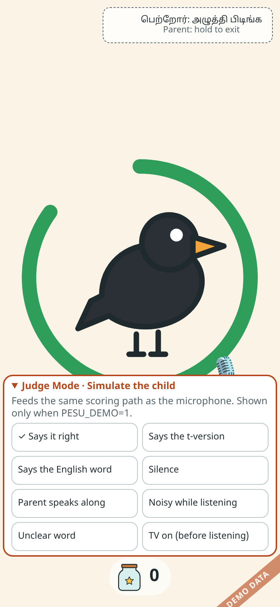 | 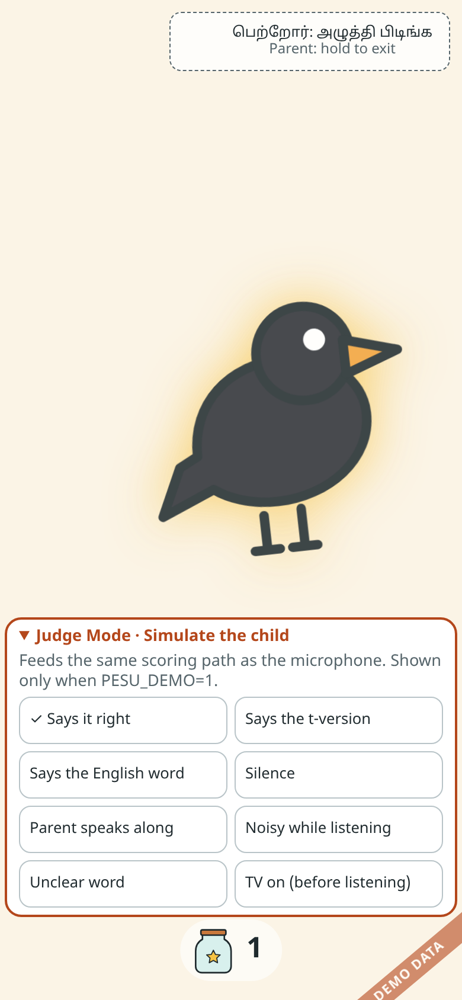 | 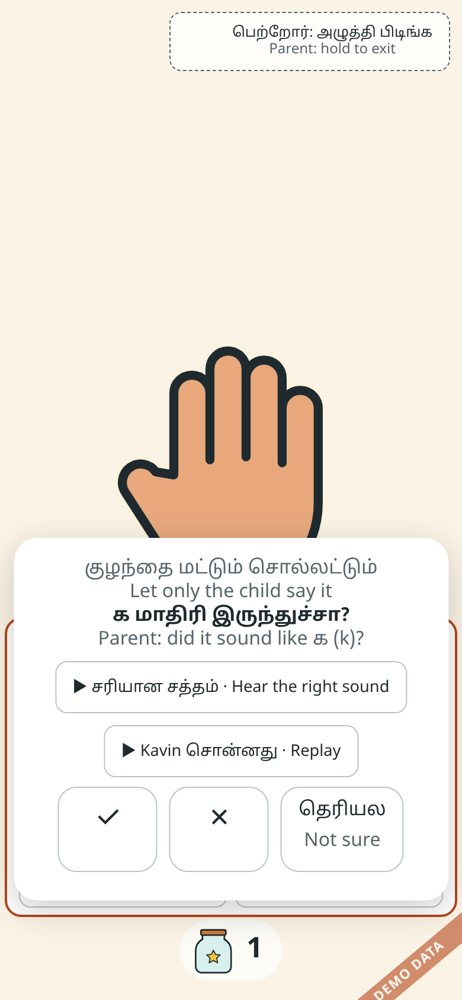 |

| Parent: today | Parent: summary | Sticker garden |
|---|---|---|
| 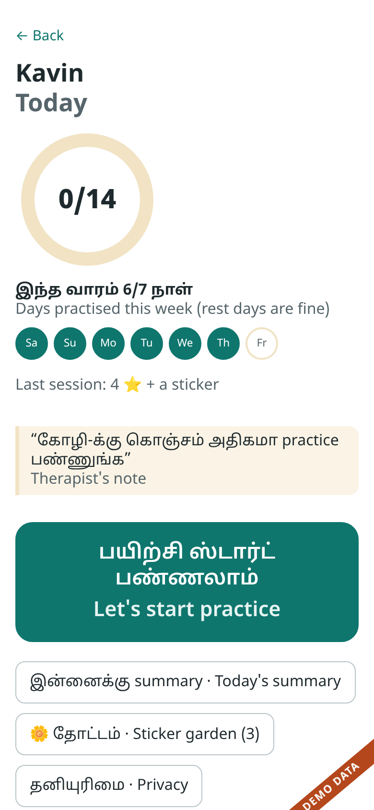 | 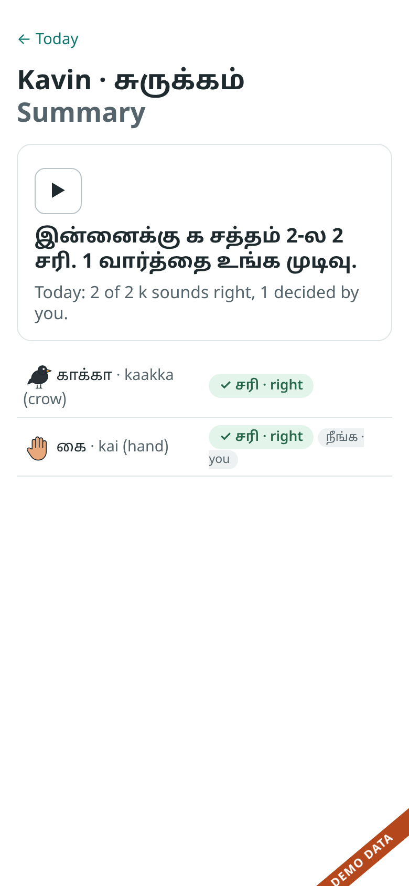 | 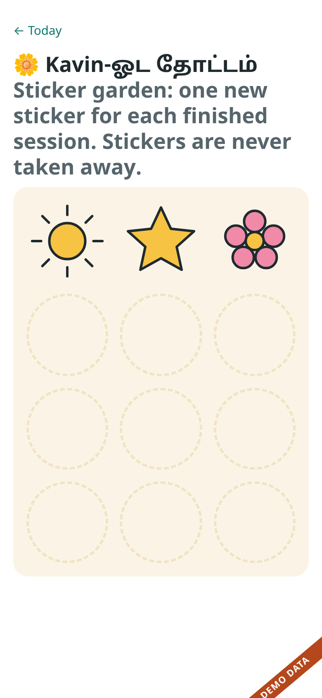 |

| Therapist: review | Therapist: setup |
|---|---|
| 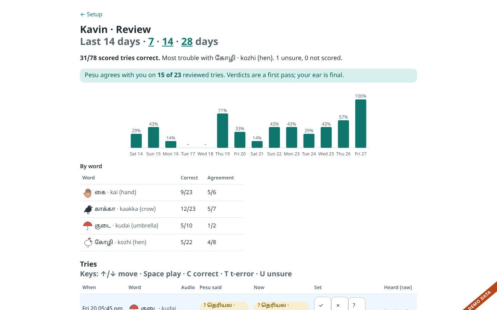 | 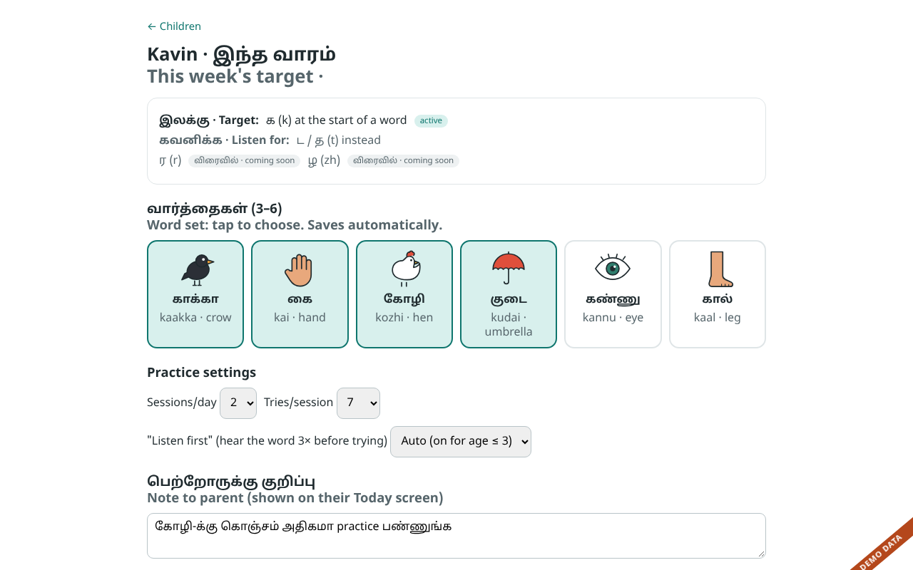 |

Demo video: **TODO** (link to be added by the owner).

## What's new in v0.2

v0.1 was the Round 2 prototype. v0.2 fixes every defect found in a code audit (IDs A1–A20) and adds the features below. Each line points to code and the test that proves it.

<details open><summary><b>Defects fixed</b></summary>

| ID | Defect in v0.1 | Fix | Proof |
|---|---|---|---|
| A1 | A silent child made the session loop forever | 3 idle words → "still here?" pause; caps of 12 prompts and 6 minutes | `test_silent_child_gets_pause_screen` |
| A2 | Recogniser errors became a false "speak louder" | Each error mapped to a kind parent message; `network` → record-only | `test_record_only_when_recogniser_offline` |
| A3 | "Today" rolled over at 05:30 IST; times shown 5.5 h off | UTC `Z` timestamps, day boundaries in `PESU_TZ` | `test_today_counts_roll_over_at_ist_midnight`, `test_local_day_around_ist_midnight` |
| A4 | After exit, an in-flight try was still scored, saved and praised | One session object; every await is guarded; exit aborts recognition, sound and mic | `test_exit_mid_try_stops_everything` |
| A5 | Therapist routes were open to anyone on the network | Signed HttpOnly cookie on every therapist route; 5-try PIN lockout; changeable PIN | `test_therapist_routes_need_token` (10 routes), `test_pin_lockout_after_five_failures`, `test_tampered_token_rejected` |
| A6 | Any bytes accepted as audio; Safari files mislabelled | Magic-byte sniffing (WebM/Ogg/MP4/WAV), streamed 2 MB cap, MIME from content | `test_clip_upload_sniffs_type`, `test_upload_rejects_text_and_oversize` |
| A7 | Google Fonts loaded at runtime (leaks the child's IP) | Self-hosted Noto Sans Tamil (80.5 KB) | `tests/e2e/conftest.py` fails any test that makes an outbound request |
| A8 | Emoji pictures rendered as tofu on older Android | 6 original SVG word pictures + 12 SVG stickers | [`app/static/img`](app/static/img) |
| A9 | A new AudioContext per chime (leak) | One shared context for every earcon | [`sound.js`](app/static/js/sound.js) |
| A10 | Summary hard-coded "today" and counted unsure as wrong | Built from data; denominator = scored tries only; Tamil number words when spoken | `test_summary_counts_scored_only` |
| A11 | Overrides overwrote history | Append-only `verdict_events`; `pesu_verdict` immutable; ✓/✗/? + note | `test_override_audit_trail_and_agreement` |
| A12 | Deprecated startup hook, positional inserts, no migrations | `lifespan`, named inserts, whitelisted updates, `PRAGMA user_version` migrations, WAL, foreign keys | `test_migrates_v01_volume_in_place` |
| A13 | Container ran as root with no health check | uid 10001, `HEALTHCHECK`, read-only root filesystem | [`Dockerfile`](Dockerfile), [`docker-compose.yml`](docker-compose.yml) |
| A14 | No delete, no export | Typed-name delete (rows cascade, audio folder removed) and a ZIP export | `test_delete_cascades_rows_and_files`, `test_export_zip_contents` |
| A15 | Sample child seeded in real use | Only with `PESU_DEMO=1`; ribbon; "Remove demo data" | `test_no_demo_seed_when_off`, `test_demo_remove_and_fast_forward` |
| A16 | Fixed 4 s window cut off slow toddlers | 6/5/4 s by age, +2 s after a slow try (cap 8 s), stop 1.2 s after speech ends | `listenWindow()` in [`mic.js`](app/static/js/mic.js) |
| A17 | Recogniser confidence ignored | Captured, stored, used (`PESU_MIN_CONF`) | golden cases `low_conf` |
| A18 | Back button or refresh lost the session | Back opens a confirm; session counters survive a refresh | [`practice.js`](app/static/js/practice.js) |
| A19 | Fixed 6 s TTS timeout cut long lines | Timeout from text length, cleared on end | [`sound.js`](app/static/js/sound.js) |
| A20 | Only the scorer was tested | 181 unit/API tests + 10 browser tests | [Testing](#testing) |

</details>

## Features by person

**Child** ([`practice.js`](app/static/js/practice.js))

| Feature | Why it helps | ID |
|---|---|---|
| One big original picture; tap it to hear the prompt again | Toddlers tap; now the tap does something useful | B1, B5 |
| Three distinct turns: warm glow while Pesu speaks; rising earcon + green ring that shrinks while listening; a nod while thinking; falling earcon when the turn ends | The child always knows whose turn it is, by sight **and** sound | B6 |
| Listening window by age, longer after a slow start | Shy or slow starters aren't cut off | B8 |
| "Listen first": hear the word 3× before trying (auto-on for age ≤ 3, therapist can change) | A standard therapy technique, therapist-controlled | B9 |
| Mistakes get a head tilt and sparkle, one retry, then "next picture"; the word comes back once later | Never feels like failure | B10 |
| After two misses in a row, the next word is the child's best word | A guaranteed win keeps motivation up | B11 |
| 8 praise lines, never the same twice; the first success on a word names the sound ("நல்ல க சத்தம்!") | Specific, varied praise | B12 |
| Stars in a jar; one new sticker per finished session, kept forever in a garden | Rewards grow, never shrink. No streaks, no loss | B13 |
| Record-only mode when the recogniser is offline | Practice is never wasted; the therapist listens later | B20 |
| Goal reached → sleepy moon "இன்னைக்கு போதும்!" | Healthy limits (7 tries, ≤ 6 min, sessions/day) | B23 |
| Wake lock, no context menu, no overscroll, 800 ms tap debounce, hold-to-exit with a filling ring | Touch-safe for small hands | B2, B3 |
| `prefers-reduced-motion` honoured | Fades instead of flying | B4 |

**Parent** ([`parent.js`](app/static/js/parent.js))

| Feature | Why it helps | ID |
|---|---|---|
| Today: tries ring, "days practised this week" dots (rest days allowed), last session, therapist's note | One glance, no guilt | C2 |
| Verdict strip asks "did it sound like க?" with ▶ the therapist's model sound and ▶ the child's own clip | Judge against a reference, not memory | C4 |
| Summary sentence "இன்னைக்கு க சத்தம் 7-ல 4 சரி. 1 வார்த்தை உங்க முடிவு." with ▶ | Plain language, no percentages | C5, A10 |
| Mic + room check with live meter, volume slider, earcon test | Setup without training | C1 (light), B18 |
| Kind, actionable failure messages in Tamil and English (spoken once) | No error codes | C12, A2 |
| Privacy page in plain words | Knows what is recorded and what leaves the device | C10 |

**Therapist** ([`therapist.js`](app/static/js/therapist.js))

| Feature | Why it helps | ID |
|---|---|---|
| Roster: today's tries, last practised, needs-review count, red dot after 3 days without practice, search | See who needs attention | D1 |
| Setup in one screen with autosave: word set, sessions/day, tries/session, listen-first, note | Fast weekly update | D2 |
| Recording studio: hold-to-record, live level, rejects too-short / too-quiet clips, warns on clipping; coverage "4/4 prompts, 3/4 cues" | Her voice is what the child hears; missing cues are visible | D4, B19 |
| Review queue: unsure/unscored first, then parent-decided, then low confidence; ↑/↓, Space, C/T/U keys; auto-plays on focus | Review 20 tries quickly from the keyboard | D5 |
| "Pesu agrees with you on X of Y reviewed tries", overall and per word | The honest measure of whether recognition works for this child | D7 |
| Full history per try: Pesu's first pass, parent decision, every override with time and note | Nothing is silently lost | D8, A11 |
| Mic test + "simulate the recogniser" box | Debug or demo without speaking | D11 |
| Export ZIP, typed-name delete, PIN change, lock button | Data control and safety | A14, D12 |

## Architecture

**Components**

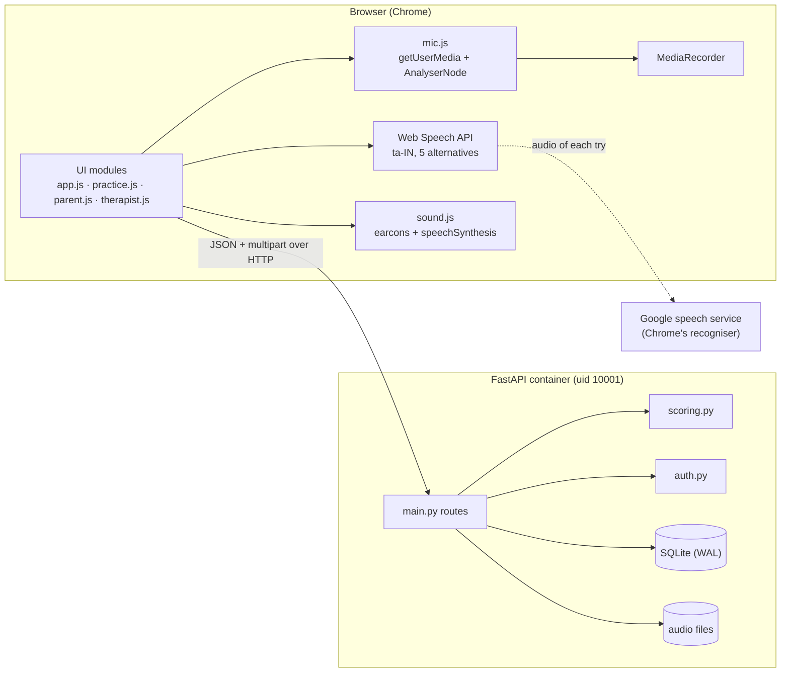

**One practice try**

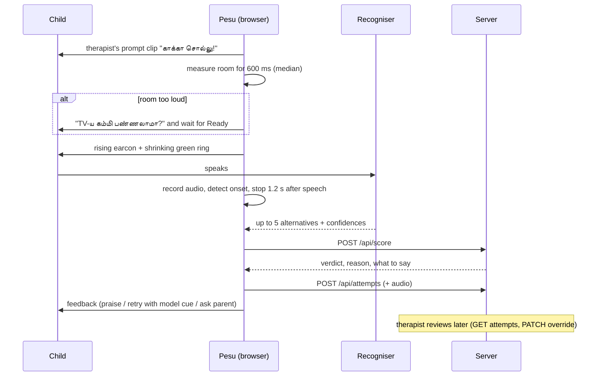

**Per-word state machine**

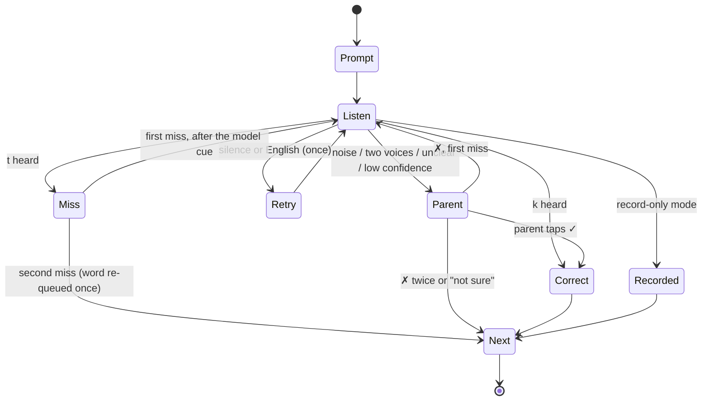

**Data model**

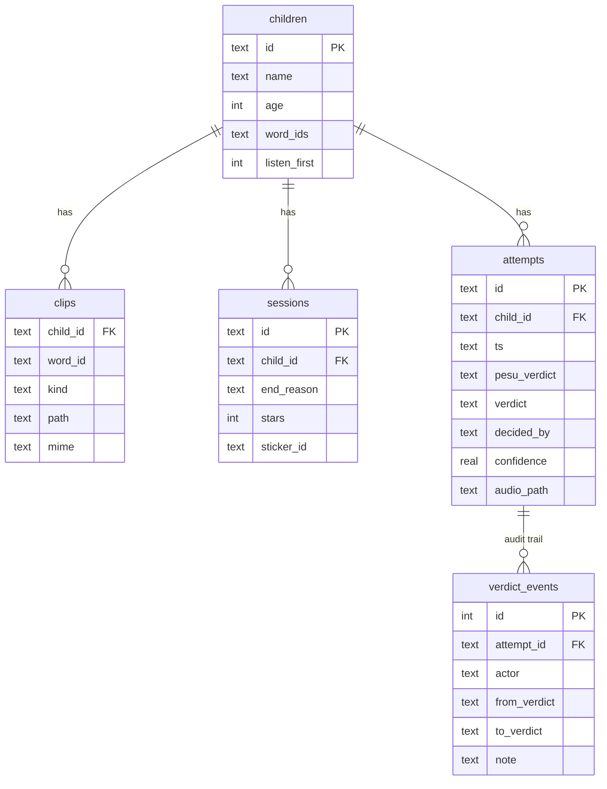

**What leaves the device**

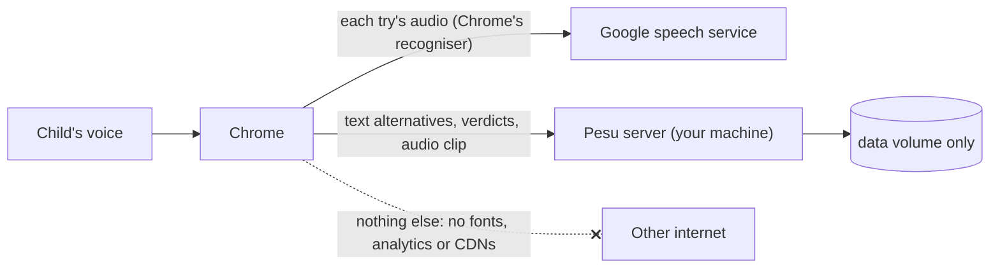

## The scoring engine

[`app/scoring.py`](app/scoring.py) judges **one thing**: did the word start with the target sound (க / k) or with the substitution (ட, த / t)? Everything it can't decide cleanly goes to the parent.

**1. Normalise.** NFC-normalise, remove zero-width joiners, keep only Unicode letters, marks and numbers, lowercase. The pitfall this avoids: Tamil vowel signs are Unicode **marks** (category M). The usual `[^\w\s]` punctuation regex deletes them, so `காக்கா` becomes `க க க` and nothing matches. v0.1 hit this bug; `normalise()` now keeps `L`, `M` and `N` categories explicitly.

**2. Classify a token.** If it starts with க/k and is within 2 edits of the word or an accepted variant → `correct`. If it starts with ட/த/t and swapping that first letter for க/k gives the word (டாக்கா → காக்கா) → `error_t`. English equivalents → `english`.

**3. Decide, in this order** (first match wins):

1. no text → **silence**
2. room noisy while listening → **unsure (noise)**: noise never makes a try "wrong"
3. top alternative has more than one distinct word → **unsure (multi)**: usually the parent speaking along. A repeated word ("காக்கா காக்கா") counts as one
4. top alternative is k or t → **correct / error_t**, unless top confidence is positive and below `PESU_MIN_CONF` → **unsure (low_conf)**
5. top alternative is English → **retry**: "say it in Tamil", not counted
6. lower alternatives all agree → that verdict
7. anything else → **unsure (unclear)**: the parent decides

Why the top alternative wins: browser recognisers autocorrect towards dictionary words, so a child's "taakka" often comes back with காக்கா as a *lower* alternative. Trusting any alternative would turn mistakes into successes.

Confidence pitfall: Chrome reports `confidence = 0` for some results (often lower alternatives, sometimes everything on Android). Pesu treats 0 as "not reported", not "certainly wrong". The 0.35 threshold is **not calibrated**.

**Worked examples**, produced by running `score()` (regenerated by `make docs`):

<!-- BEGIN:truth -->
| Word | Recogniser alternatives | Conf. | Noise | Verdict | Reason | Pesu says | Case |
|---|---|---|---|---|---|---|---|
| kaakka | `காக்கா` | – | 0.01 | **correct** | correct | சூப்பர்! | clear k |
| kaakka | `டாக்கா` | – | 0.01 | **error_t** | error_t | இன்னொரு தடவை! | k replaced by ட |
| kai | `தை` | – | 0.01 | **error_t** | error_t | இன்னொரு தடவை! | k replaced by த |
| kaakka | `taakka` | – | 0.01 | **error_t** | error_t | இன்னொரு தடவை! | Roman spelling with t |
| kozhi | `கோலி` | – | 0.01 | **correct** | correct | சூப்பர்! | dialect form accepted |
| kaakka | `crow` | – | 0.01 | **retry** | english | தமிழ்ல சொல்லு: காக்கா! | English word |
| kaakka | (none) | – | 0.01 | **silence** | silence | கேக்கல... சத்தமா சொல்லு! | nothing heard |
| kaakka | `காக்கா` | – | 0.2 | **unsure** | noise | கொஞ்சம் சத்தமா இருக்கு. TV-ய கம்மி பண்ணலாமா? | room got noisy |
| kaakka | `காக்கா சொல்லு` | – | 0.01 | **unsure** | multi | குழந்தை மட்டும் சொல்லட்டும் | parent speaking along |
| kaakka | `டாக்கா காக்கா` | – | 0.01 | **unsure** | multi | குழந்தை மட்டும் சொல்லட்டும் | self-correction |
| kaakka | `காக்கா காக்கா` | – | 0.01 | **correct** | correct | சூப்பர்! | child repeats the word |
| kaakka | `டாக்கா`, `காக்கா` | – | 0.01 | **error_t** | error_t | இன்னொரு தடவை! | autocorrected lower alternative ignored |
| kaakka | `பாப்பா`, `காக்கா`, `காக்கா` | – | 0.01 | **correct** | correct | சூப்பர்! | top unclear, lower ones agree |
| kaakka | `காக்கா` | 0.2 | 0.01 | **unsure** | low_conf | சரியா இருந்துச்சா? | low recogniser confidence |
| kaakka | `காக்கா` | 0.0 | 0.01 | **correct** | correct | சூப்பர்! | confidence 0 = not reported |
<!-- END:truth -->

**Known failure modes:** autocorrection of the child's error into the right word (mitigated, not solved: the therapist hears the audio); Tamil homophones and minimal pairs (தோழி "friend" for கோழி "hen" is correctly an `error_t`, but a recogniser may not produce it); parent co-speech (detected only when the recogniser returns both words); adult-trained recognition on child speech in general.

## Technology choices

| Chose | Considered | Why | Cost |
|---|---|---|---|
| Browser Web Speech API (`ta-IN`) | On-device ASR (Whisper/Vosk-class models), paid Indic speech APIs | Free, no key, Tamil supported in Chrome, no model download. **Considered, not benchmarked:** accuracy of any option on Tamil child speech is unproven | ₹0; audio goes to Google via Chrome |
| Deterministic scoring rules | An LLM or acoustic classifier | Judging one consonant needs a narrow, testable rule; every verdict is explainable | ₹0 |
| FastAPI | Flask, Django | Typed request validation, OpenAPI for free, small | ₹0 |
| SQLite (WAL) | Postgres | One file, zero setup, enough for a clinic; backup is one call | ₹0 |
| Vanilla JS ES modules | React/Vue | No build step, ~73 KB of JS, easy to audit for a CSP | ₹0 |
| Web app | Native app | Runs on any phone with Chrome, no store review | ₹0 |

## API reference

Generated from the FastAPI app by `make docs`; the full schema is in [`docs/openapi.json`](docs/openapi.json). "therapist" routes need the signed cookie set by `POST /api/pin`.

<!-- BEGIN:api -->
| Method | Path | Auth | What it does |
|---|---|---|---|
| GET | `/api/health` | open | Health |
| GET | `/api/config` | open | Config |
| POST | `/api/pin` | open | Check Pin |
| POST | `/api/logout` | open | Logout |
| GET | `/api/auth` | open | Auth Status |
| POST | `/api/pin/change` | therapist | Pin Change |
| GET | `/api/children` | open | Open list for the parent picker: no therapist notes unless the caller is the therapist. |
| POST | `/api/children` | therapist | Add Child |
| GET | `/api/children/{child_id}` | therapist | Get Child |
| PUT | `/api/children/{child_id}` | therapist | Update Child |
| DELETE | `/api/children/{child_id}` | therapist | A14: rows cascade via foreign keys; the child's audio folder is removed from disk. |
| GET | `/api/children/{child_id}/practice` | open | Everything the parent/child screens need, and nothing more (no therapist notes). |
| PUT | `/api/children/{child_id}/clips/{word_id}/{kind}` | therapist | Upload Clip |
| GET | `/api/children/{child_id}/clips/{word_id}/{kind}` | open | Get Clip |
| POST | `/api/score` | open | Score Try |
| POST | `/api/sessions` | open | Start Session |
| PATCH | `/api/sessions/{session_id}` | open | Ends a session. B13: a session the child finished earns one new sticker (never more, never lost). |
| POST | `/api/attempts` | open | Save Attempt |
| GET | `/api/attempts/{attempt_id}/audio` | open | Attempt Audio |
| GET | `/api/children/{child_id}/summary` | open | A10/C5: counts for the parent. Denominator = scored tries only; unsure/unscored reported apart. |
| GET | `/api/children/{child_id}/attempts` | therapist | List Attempts |
| PATCH | `/api/attempts/{attempt_id}` | therapist | A11: sets the therapist's verdict and appends it to the audit trail; pesu_verdict never changes. |
| GET | `/api/children/{child_id}/export` | therapist | A14: ZIP with attempts.csv, verdict_events.csv, sessions.csv, audio/ and README.txt. |
| POST | `/api/demo/remove` | therapist | Demo Remove |
| POST | `/api/children/{child_id}/demo/fast-forward` | therapist | Demo Fast Forward |
| GET | `/` | open | Index |
<!-- END:api -->

```bash
# verified: score a try (output trimmed)
curl -s -X POST localhost:3000/api/score -H 'content-type: application/json' \
  -d '{"word_id":"kaakka","alternatives":["டாக்கா"],"confidences":[0.8]}'
{"word_id":"kaakka","heard":"டாக்கா","noise_rms":0.0,"confidence":0.8,"verdict":"error_t","reason":"error_t","say_ta":"இன்னொரு தடவை!","say_en":"Innoru thadava!"}
```

## Data model and storage

- **Tables:** `children`, `clips`, `sessions`, `attempts`, `verdict_events` (append-only), `settings` (PIN hash, lockout). Foreign keys with `ON DELETE CASCADE`; `PRAGMA foreign_keys=ON` on **every** connection (SQLite turns it off by default).
- **Migrations:** [`app/migrations/`](app/migrations) run in order, tracked by `PRAGMA user_version`. A v0.1 database is rebuilt in place (timestamps converted to UTC `Z`) and keeps its data (`test_migrates_v01_volume_in_place`).
- **Audio on disk:** `data/audio/<child>/clips/<word>-<prompt|cue>.<ext>` and `data/audio/<child>/tries/<attempt-id>.<ext>`. The extension and MIME come from the sniffed content.
- **Retention:** child audio older than `PESU_AUDIO_RETENTION_DAYS` (90) is deleted at startup; verdict rows are kept so charts still work (`test_retention_removes_old_audio_keeps_rows`).
- **Backup / restore:** `scripts/backup.sh` (online SQLite `.backup` + audio + secret, as a tar.gz) and `scripts/restore.sh`. Round trip tested in `test_backup_restore_round_trip`.

## Security and privacy

**Threat model** ("child-proof gate + LAN-grade auth, not hospital-grade")

| Asset | Threat | Mitigation | Residual risk |
|---|---|---|---|
| Therapist screens | PIN brute force | 5 failures → 60 s lockout, persisted; constant-time compare; PIN 4–6 digits, changeable; startup warning while default | A 4-digit PIN is weak against a patient attacker on the LAN |
| Therapist session | Token theft / forgery | HMAC-SHA256 token, per-install random secret in the data volume, `HttpOnly; SameSite=Strict`, 15 min idle expiry | No HTTPS by default: anyone sniffing the LAN can read the cookie |
| Server | Upload abuse | Magic-byte sniffing (415), streamed 2 MB cap (413), whitelisted word/kind | Valid-looking but malicious media isn't parsed server-side |
| Files | Path traversal | Stored paths resolved and confined to the data dir (`safe_path`) | — |
| Browser | XSS | Every value HTML-escaped; CSP `script-src 'self'`, no inline handlers (checked by `scripts/check_static.py`) | `style-src` allows inline styles (template `style=` attributes) |
| Browser | CSRF | `SameSite=Strict` cookie; JSON APIs | — |
| Child data | Exfiltration | No analytics, no third-party requests (an e2e check fails on any); delete + export | Anyone with therapist access can export |
| Child audio | Third-party processing | Only Chrome's recogniser sends audio, to Google; documented on the Privacy page | Inherent to the Web Speech API; on-device recognition not verified (below) |

**What Chrome sends to Google:** Chrome's built-in `SpeechRecognition` streams each try's audio to Google's speech service to get the text. Pesu itself sends nothing anywhere else. **On-device recognition (E8): not verified.** Chrome's newer on-device option could not be tested for `ta-IN` here, so Pesu doesn't claim it.

**Design intent (not legal advice or a compliance claim):** India's Digital Personal Data Protection Act 2023 gives children's data extra protection and requires a parent's consent. Pesu is designed for data minimisation (no accounts, no analytics), local storage, retention limits, and delete/export controls.

## Accessibility and child-safe design

- **Never colour alone:** verdicts are text + symbol + colour (`✓ சரி`, `✗ t`, `? தெரியல`).
- **Targets:** parent verdict buttons 72 px, child picture ≥ 50% of the screen, other controls ≥ 44 px.
- **Captions:** every spoken line is shown in Tamil with English below (`aria-live`).
- **Reduced motion:** honoured globally; flying becomes a fade.
- **Flashing:** no element flashes; animations are 0.3–1.1 s and at most one moves at a time.
- **Keyboard:** therapist review is fully keyboard-operable; visible focus ring.
- **Child-safe:** no external links, ads or analytics, no free text and no settings on the child screen; exit needs a 1.2 s hold; Back opens a confirm.
- **Why errorless feedback:** a child who hears a buzzer stops trying. Pesu tilts, sparkles, models the sound, and moves on after two misses.
- **Not done:** an automated axe-core audit and Lighthouse (see [Honesty](#honesty-what-is-real-what-is-simulated-what-is-not-validated)).

## Clinical grounding

Pesu borrows common speech-therapy practices: home practice between sessions, therapist-chosen targets, the therapist's model of the sound, a short listen-first phase, keeping success high to protect motivation, and short sessions. It makes **no efficacy claims**. **Therapist-validated: no (pending).** The word list, cues, praise lines and coaching tips are **suggestions for a therapist to confirm**.

## Reliability: failure modes

| Scenario | Detection | Behaviour | Proof |
|---|---|---|---|
| Mic denied | `getUserMedia` / `not-allowed` | Kind message, practice stops; Judge Mode still works | `REC_ERRORS` in `mic.js` |
| No internet for the recogniser | `network` error | Parent message, then record-only (`unscored`) | `test_record_only_when_recogniser_offline` |
| Browser without speech recognition | feature detection | Record-only, or Judge Mode in demo | banner in `app.js` |
| Tamil TTS voice missing | no `ta` voice | Therapist's clips are used; captions always shown | `sound.js` |
| Android shared-mic conflict | `audio-capture` | Stops saving clips on that phone, keeps practising | `mic.js` |
| Noisy room | median RMS ≥ threshold | Pauses before listening; noise during a try → unsure | `test_noise_gate_pauses_before_listening` |
| Silent child | 3 idle words | "Still here?" screen; caps of 12 prompts / 6 min | `test_silent_child_gets_pause_screen` |
| Exit mid-try | hold or Back | Aborts recognition, sound, mic; no later requests | `test_exit_mid_try_stops_everything` |
| Refresh mid-session | `sessionStorage` | Counters resume within 6 min | `practice.js` (manual check) |
| Server restart | — | SQLite WAL; PIN lockout persisted | `test_pin_lockout_after_five_failures` |
| Day boundary / time zone | `PESU_TZ` | IST midnight, not 05:30 | `test_today_counts_roll_over_at_ist_midnight` |
| DB locked / disk full | 5 s busy timeout / write error | Error message with a "Go home" button (never a blank screen) | `app.js` error boundary (manual) |

## Performance and footprint

Measured with [`scripts/measure.py`](scripts/measure.py) on the development sandbox (Python 3.13, local loopback):

```text
# verified: python scripts/measure.py
cold start (process start -> /api/health 200): 0.41 s
/api/score latency, 1000 sequential local calls: p50 1.92 ms, p95 2.88 ms
database growth for 1000 tries without audio: 228 KB
front end (uncompressed): JS 72.8 KB, CSS 13.5 KB, fonts 80.5 KB, SVG art 9.8 KB
```

Not measured here: Docker image size, real audio size per try, the in-browser latency from prompt end to "your turn" (estimated by design at ~1 s: a 600 ms noise sample plus a 400 ms earcon; target was ≤ 700 ms), and Lighthouse.

## Testing

```text
# verified: make test
181 passed in 1.46s
# verified: make e2e   (Chromium, real server, Judge Mode + stubbed recogniser)
10 passed in 42.81s
# verified: make coverage
TOTAL    806     44    95%
# verified: make eval
golden cases: 128  passed: 128  failed: 0
Note: logic regression set, not a measure of real-world accuracy.
```

<!-- BEGIN:tests -->
| File | Tests | What it proves |
|---|---|---|
| `tests/e2e/test_practice_flow.py` | 10 | real browser: Judge Mode, stubbed recogniser, exit, record-only, override |
| `tests/test_api.py` | 34 | auth on every therapist route, PIN lockout, uploads, audit trail, delete/export, stickers |
| `tests/test_backup.py` | 1 | backup.sh → restore.sh round trip |
| `tests/test_scoring.py` | 9 | original v0.1 scorer cases (unchanged) |
| `tests/test_scoring_golden.py` | 131 | 128-case golden logic set + 3,000-input seeded fuzz + normalise stability |
| `tests/test_time_and_migration.py` | 6 | IST midnight boundaries, v0.1 → v0.2 migration, audio retention |
| **Total** | **191** | |
<!-- END:tests -->

**Why the recogniser is stubbed in e2e:** headless Chrome's real recogniser needs Google's servers and is flaky. Tests either press Judge Mode buttons (which feed the same code path) or replace `window.SpeechRecognition` with a stub that returns scripted alternatives. Every e2e test also **fails if the page makes any request outside the app's own server**.

**The golden set** ([`tests/golden_scoring.csv`](tests/golden_scoring.csv), 128 cases) checks the decision logic across every word: Tamil, Roman and English spellings, repeats, self-correction, parent co-speech, silence, noise, dialect forms and confidence. It is a **logic regression set, not a measure of real-world accuracy**: its inputs are text, not children's voices.

## Configuration

Every variable is optional. Generated from [`app/config.py`](app/config.py):

<!-- BEGIN:env -->
| Variable | Default | What it does |
|---|---|---|
| `PESU_THERAPIST_PIN` | `1234` | Initial therapist PIN (4-6 digits). Once changed in the app, the stored PIN wins. |
| `PESU_NOISE_THRESHOLD` | `0.05` | Background RMS (0-1) above which Pesu pauses before listening. |
| `PESU_TZ` | `Asia/Kolkata` | Time zone used for 'today' and per-day charts. |
| `PESU_DEMO` | `0` | 1 = seed the sample child and enable Judge Mode. docker-compose.yml sets 1. |
| `PESU_MIN_CONF` | `0.35` | Top recogniser confidence below this turns a definite verdict into 'unsure'. Uncalibrated. |
| `PESU_DATA_DIR` | `./data` | Where the SQLite DB, audio and the token secret live. |
| `PESU_AUDIO_RETENTION_DAYS` | `90` | Child audio older than this is deleted at startup; verdict rows are kept. |
| `PESU_SECRET_FILE` | (derived) | Path of the token-signing secret. Default: <PESU_DATA_DIR>/secret.key (created on first run). |
| `PESU_MAX_AUDIO_BYTES` | `2097152` | Largest accepted audio upload in bytes (default 2 MB). |
<!-- END:env -->

## Deployment and operations

| Task | How |
|---|---|
| Run with Docker | `docker compose up --build` → http://localhost:3000 |
| Run without Docker | `pip install -r requirements.txt` then `make run` |
| Real use (no demo data) | `PESU_DEMO=0 docker compose up --build` |
| Phone over USB | `adb reverse tcp:3000 tcp:3000`, then open `http://localhost:3000` on the phone |
| Phone over Wi-Fi | Needs HTTPS (the mic needs a secure page): put a reverse proxy such as Caddy with an internal certificate in front of port 3000. Not verified here |
| Back up / restore | `make backup`; `sh scripts/restore.sh BACKUP.tar.gz ./data` (stop Pesu first) |
| Upgrade | Pull, rebuild; migrations run at start |
| Reset the PIN | Delete the `pin_hash` and `pin_salt` rows in `settings`, or the whole data volume |
| Health | `GET /api/health` (Docker `HEALTHCHECK` uses it) |
| Logs | `docker compose logs pesu`. No transcripts or audio are logged |

## Troubleshooting

| Symptom | Cause | Fix |
|---|---|---|
| "port is already allocated" | Something else uses 3000 | Stop it (`netstat -ano \| findstr :3000` on Windows), or run `docker run --rm -p 3001:3000 pesu-pesu` |
| Crashes with "readonly database" after upgrading from v0.1 | The old data volume belongs to root; v0.2 runs as uid 10001 | `docker compose down -v` (deletes old data), then up again |
| Mic does nothing on `http://<LAN-IP>:3000` | Browsers allow the mic only on secure pages | Use `localhost`, `adb reverse`, or HTTPS |
| "No internet for speech recognition" | Chrome's recogniser is online-only | Pesu switches to record-only; the therapist listens later |
| Never hears anything | Wrong mic, or Firefox/Safari | Use Chrome; check the mic test on the parent screen |
| "Audio clips can't be saved on this phone" | Some Android builds won't share the mic between recorder and recogniser | Practice continues; clips aren't saved on that phone |
| Every try is "unsure (noise)" | Room above `PESU_NOISE_THRESHOLD` | Quieter room, or raise the threshold slightly |
| "taakka" scored as correct | Recogniser autocorrected | Expected limit; the therapist hears the audio and overrides |
| Tamil looks like boxes | Font blocked or very old browser | The font is self-hosted in `app/static/fonts`; update Chrome |
| Times look 5.5 h off | Wrong `PESU_TZ` | Set `PESU_TZ` to your zone |
| "Too many tries. Wait 60 s" | PIN lockout | Wait a minute |
| Safari recordings won't play | v0.1 mislabelled MP4 as WebM | Fixed: the MIME comes from the file's content |
| Pesu says nothing aloud | No Tamil TTS voice and no recorded clips | Record prompts and cues on the therapist side |

## Project structure

```text
app/
  main.py           routes, security headers, startup (migrations, demo seed, retention)
  scoring.py        the k-vs-t decision (pure function) + what Pesu says
  words.py          target, word bank (+ variants), stickers, praise lines
  auth.py           PIN, lockout, signed cookie
  audio.py          upload sniffing, streamed size cap, safe paths
  db.py             SQLite connections, migration runner, named insert / whitelisted update
  timeutil.py       UTC storage, PESU_TZ day boundaries, test clock
  demo.py           sample child + 2-week fast-forward (tagged sample)
  migrations/       001_initial.sql (v0.1), 002_v02.sql
  static/           index.html, styles.css, js/ (ES modules), img/ (original SVG), fonts/ (OFL)
tests/              unit + API + golden set; e2e/ (Playwright)
scripts/            eval_scoring, gen_docs, verify_readme, gen_screenshots, measure, check_static, backup/restore
docs/               screenshots/, openapi.json, demo-script.md, CLAIMS.md
```

## Roadmap

1. **Child-speech recognition:** a phoneme-level model for Tamil child speech, which needs consented recordings, therapist annotation and an ethics process. This is the real accuracy bottleneck.
2. **More sounds:** ர and ழ word banks with tests (the data structure is ready).
3. **Not built in v0.2:** a perception game with minimal pairs (pairs need therapist validation first), syllable → word → phrase levels, the bubble break, the PWA with reminders, Tamil/English/Tanglish language files, 12-week trends.
4. **Accounts and sync** across devices, for clinics.
5. **A small pilot with Tamil Nadu clinics** (a plan, not a claim): 3 therapists, 30 families, 8 weeks, measuring practice days and Pesu–therapist agreement.

## Honesty: what is real, what is simulated, what is not validated

- **Real:** recording, recognition through Chrome, scoring, storage, review, overrides, audit trail, delete/export.
- **Simulated:** Judge Mode inputs; the sample child and the "fast-forward" history (always tagged *sample*).
- **Not validated:** recognition accuracy on children's Tamil speech; clinical benefit; therapist review of the word list, cues and tips.
- **Could not verify in the build sandbox:** `docker compose up` (no Docker daemon there; the owner ran v0.1's Docker build successfully on Windows); the GitHub Actions workflow; a real phone and `adb reverse`; Chrome on-device recognition for `ta-IN`; axe-core and Lighthouse audits. (The 5 Mermaid diagrams were rendered successfully with `mmdc`.)

## Judging criteria map

The official rubric wasn't available, so this maps the brief's stated requirements.

| Requirement | Where |
|---|---|
| Main task done by speaking | [The scoring engine](#the-scoring-engine), [Architecture](#architecture) |
| One core flow end to end | [Try it in 90 seconds](#try-it-in-90-seconds), e2e tests |
| Starts with `docker compose`, port 3000, no keys | [Try it in 90 seconds](#try-it-in-90-seconds), [`docker-compose.yml`](docker-compose.yml) |
| Problem and users | [The problem](#the-problem) |
| What it depends on, if it gets costly | [Technology choices](#technology-choices), [Security and privacy](#security-and-privacy) |
| Own code (~300+ lines) | about 4,500 lines across `app/`, `tests/`, `scripts/` |

## Claims ledger

Full list: [`docs/CLAIMS.md`](docs/CLAIMS.md). Every number in this README comes from a pasted command output, a generated section, or a linked source.

## Credits and licences

- **Code:** MIT (see [`LICENSE`](LICENSE)). Author: Subhitcha, Coimbatore Institute of Technology.
- **Font:** Noto Sans Tamil, © The Noto Project Authors, SIL Open Font License 1.1 ([`app/static/fonts/OFL.txt`](app/static/fonts/OFL.txt)), via the Fontsource package.
- **Illustrations:** the 6 word pictures, 12 stickers, jar, moon and icon in [`app/static/img`](app/static/img) are original SVGs written for this project, released under the project licence.
- **Sounds:** generated at runtime with the Web Audio API; no audio files are bundled.
- **Libraries:** FastAPI 0.115.6 (MIT), Uvicorn 0.32.1 (BSD-3), python-multipart 0.0.20 (Apache-2.0), tzdata (Apache-2.0). Dev: pytest, pytest-cov, httpx, Playwright (Apache-2.0), Ruff (MIT).
- **AI assistance:** code, tests and this README were written with help from Claude (Anthropic).
